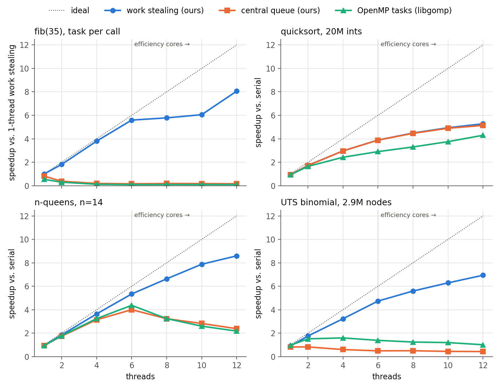
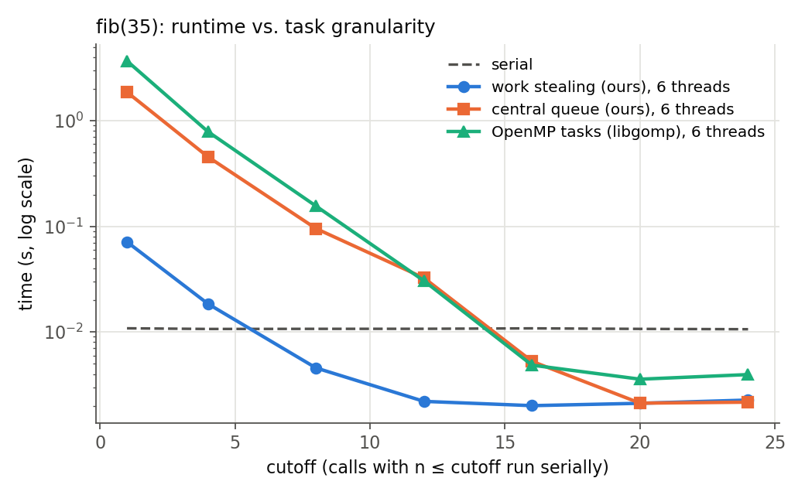

**Roger Yang (hryang)** · 15-418, Fall 2026

A small Cilk-like task runtime in C++ (a plain library, no compiler support) with spawn/sync and per-thread work-stealing deques. The goal isn't to beat Cilk or OpenMP; it's to measure how the runtime scales and how much each design choice matters: scheduler, task granularity, task allocation, victim choice and idle policy.

## Reports

- [Proposal](proposal/proposal.pdf) (Nov 9)
- [Milestone report](milestone/milestone.pdf) (Nov 23)
- Final report (Dec 10): coming soon

## Progress (Nov 23)

The runtime works: Chase-Lev deques, spawn/sync, random stealing, plus a central-queue scheduler as the first design comparison. All four benchmarks (fib, quicksort, n-queens, UTS) are done in serial, my runtime and OpenMP (as a reference). Preliminary numbers are from my laptop (M3 Pro); GHC runs are next.

## Schedule

| When | Task | Status |
|---|---|---|
| Nov 9–15 | Thread pool, deque, stress tests on ARM, spawn/sync, fib working | done |
| Nov 16–22 | Quicksort, n-queens, UTS; serial and OpenMP versions; central queue; first speedup graphs | done |
| Nov 23 | **Milestone** | done |
| Nov 23–25 | Sweep on GHC; bigger inputs for short benchmarks | |
| Nov 26–29 | Per-thread task pools; overhead breakdown for fib | |
| Nov 30–Dec 2 | Round-robin and last-victim steal policies | |
| Dec 3–6 | Idle policies (spin / yield / sleep), idle-time stats, UTS timeline plot | |
| Dec 7–8 | Final GHC runs; lazy binary splitting if ahead | |
| Dec 9–10 | Final report | |
| Dec 11 | **Poster session** | |
